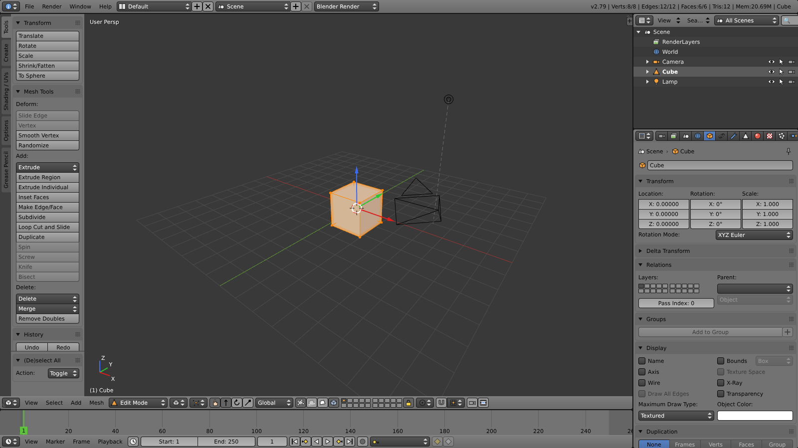

# blender-web

A browser recreation of the **Blender 2.79b** user interface, written in TypeScript with Three.js and Vite.
It aims to look, feel and behave like 2.79b: the grey theme, the area/editor system, right-click select,
G/R/S modal transforms, edit mode, the tool shelf and properties region, the Properties editor tabs,
the Outliner, the Timeline, F12 rendering, and Python scripting with `bpy`.



> The 3D text font is a Latin-1 subset of DejaVu Sans (`src/assets/fonts/`, Bitstream Vera license, see `DEJAVU-LICENSE.txt`).
>
> This is an independent fan project. It is not affiliated with or endorsed by the Blender Foundation.
> "Blender" is a trademark of the Blender Foundation. All code and icons in this repository are original.

## Quick start

```bash
npm install
npm run dev        # http://localhost:5173
```

```bash
npm run build      # type-check + production build into dist/
npm run preview    # serve the production build
npm test           # mesh-editing algorithm tests (63 tests)
```

Use a desktop browser with WebGL 2: Chrome/Edge/Firefox/Safari.
URL options: `?nosplash` skips the splash screen; `?pyodide=<url>` loads Python from a self-hosted Pyodide copy.

## What works

### Screen & UI
- Blender 2.79 default layout: Info header, 3D View, Timeline, Outliner and Properties editor.
- Screen layouts: **Default, Animation, Scripting, UV Editing, 3D View Full, Game Logic**. Switch them with Ctrl+← / Ctrl+→ or the layout dropdown.
- Areas
  - Drag the borders between areas to resize them.
  - Drag a corner's diagonal stripes inward to **split** an area, or outward into a neighbour to **join** it.
  - Ctrl+↑ maximizes an area; Alt+F10 makes it fullscreen.
  - Every area has an editor-type menu, and its header can be flipped or hidden.
- Widgets behave like 2.79's:
  - Number fields: drag, click the arrows, double-click to type, typed expressions (`2*pi`, `1m+20cm`), Ctrl+wheel, Ctrl snapping, Shift precision, Tab to the next field.
  - Sliders, checkboxes (drag across several to toggle them all), enum dropdowns, radio rows, colour picker (HSV wheel, RGB/HSV/Hex), datablock selectors and lists.
  - Over a field: **I** inserts a keyframe (the field turns yellow or green), Ctrl+C / Ctrl+V copy and paste values, Backspace resets to default.
- Menus with submenus and shortcut hints, hotkey popups (Shift+A, X, W, Shift+S, Ctrl+A, ...), the Space operator search, and tooltips that show the Python path.
- Info editor log of operator calls in Python syntax (`bpy.ops.transform.translate(value=(2, 0, 0), ...)`), plus scene statistics.
- Undo/redo (Ctrl+Z / Shift+Ctrl+Z, undo history), Repeat Last (Shift+R), and the **Adjust Last Operation** panel (bottom of the tool shelf, or F6).

### 3D View
- Navigation
  - MMB orbits; Shift+MMB pans; Ctrl+MMB or the wheel zooms.
  - Numpad 1/3/7 (with Ctrl for the opposite view) and 2/4/6/8, Numpad 5 persp/ortho, Numpad 0 camera view, Numpad . view selected, Home view all, Numpad / local view.
  - Smooth view transitions.
  - The "Emulate 3 Button Mouse" and "Emulate Numpad" preferences are supported.
- Viewport shading: Bounding Box, Wireframe, Solid, Texture, Material and Rendered (Z / Alt+Z / Shift+Z).
- Drawing: the 2.79 floor grid and adaptive ortho grid, orange selection outlines, camera, lamp and empty wireframes, the 3D cursor, the mini axis, view name and object info text.
- Selection
  - RMB selects (Shift extends; repeated clicks cycle through overlapping objects). LMB places the 3D cursor.
  - B border, C circle, Ctrl+LMB lasso, A (de)select all, Ctrl+I invert.
  - Select grouped, linked, pattern and by type.
- Transforms
  - G/R/S with X/Y/Z axis constraints (press twice for local axes) and Shift+X/Y/Z plane constraints.
  - Typed values (e.g. `G X 2 Enter`), Ctrl snapping, Shift precision, R R trackball.
  - Pivot points, transform orientations, and proportional editing (O, mouse wheel to resize).
  - Snapping to increments, vertices, edges or faces (the magnet toggle; Ctrl inverts it while transforming).
- The **manipulator** widget for translate, rotate and scale.
- Object tools
  - Add primitives (plane, cube, circle, UV sphere, icosphere, cylinder, cone, torus, grid), cameras, lamps and empties.
  - Delete, duplicate / duplicate linked, join, parent and clear parent, apply/clear transforms, set origin, smooth/flat shading.
  - Hide/unhide, the 20 **layers** (number keys, M to move objects), Ctrl+L make links, make single user, track constraints, snapping (Shift+S).
  - Ctrl+1…5 subdivision, and keyframes (I / Alt+I).
- **Sculpt mode**
  - Draw, Clay, Crease, Flatten, Grab, Inflate/Deflate, Layer, Pinch and Smooth brushes.
  - Radius, strength, falloff curves, Add/Subtract (Ctrl inverts, Shift smooths), X/Y/Z symmetry and axis locking.
  - F / Shift+F radial control, `[` / `]` radius, brush hotkeys (X, C, Shift+C, Shift+T, G, I, L, P, S), one undo step per stroke.
- **Vertex Paint mode**
  - Mix, Add, Subtract, Multiply, Lighten, Darken and Blur brushes; Ctrl paints the inverted colour, Shift blurs; Set Vertex Colors (Shift+K).
  - Colours show through modifiers and in renders via the material's "Vertex Color Paint" option.
- **Text objects**: Add > Text, Tab to type in the viewport (arrows, Home/End, Enter for new lines), size, extrude, bevel, alignment, line spacing, shear and offsets in the Data tab, and Alt+C to convert to a mesh.
- **Particle systems** (Emitter): number, start/end frame, lifetime, emit from faces or verts, normal and random velocity, gravity, size and display percentage. Drawn in the viewport and rendered as soft points.
- **Edit mode** (Tab)
  - Vertex, edge and face select modes; Alt+RMB edge and face loops; L / Ctrl+L select linked; select more/less/random/non-manifold/loose/by sides/sharp edges.
  - Extrude (E, Alt+E), Ctrl+R **loop cut and slide**, I **inset**, F make edge/face, subdivide (W), merge (Alt+M), remove doubles.
  - Delete menu, dissolve faces, separate (P), split (Y), duplicate, flip/recalculate normals, smooth and randomize vertices, triangulate / tris to quads, mirror.
  - Spin (around the 3D cursor), Hide / Hide Unselected / Reveal (H, Shift+H, Alt+H), and limit selection to visible.
- Tool shelf (T) with the 2.79 tabs, and the properties region (N): transform/median, view, 3D cursor, item and display panels.

### Other editors
- **Properties**: Render, Render Layers, Scene, World, Object, Constraints, Modifiers, Data (mesh/camera/lamp/empty), Material, Texture, Particles, Physics.
- **Modifiers** (evaluated live): Subdivision Surface (Catmull-Clark), Mirror, Array, Solidify, Triangulate, Smooth, Wave (animated), Displace, Simple Deform, Cast, Edge Split, Wireframe, Screw, Build.
- **Constraints**: Copy Location / Rotation / Scale, Limit Location / Rotation / Scale, Track To, Damped Track, Child Of.
- **Materials & textures**
  - Blender Internal style: diffuse, specular, hardness, emit, shadeless, transparency.
  - Procedural Clouds, Wood, Marble, Blend, Voronoi, Magic, Stucci and Noise textures, plus image textures, all using "Generated" coordinates with Flat/Cube/Tube/Sphere projection.
- **Outliner**: scene tree; visibility, selectability and renderability toggles; rename (double-click); context menu; drag-and-drop parenting; display modes, including "Orphan Data" and "Blender File".
- **Timeline, Dope Sheet, Graph Editor**: scrubbing, playback (Alt+A), frame range, preview range, markers and auto-keying; key selection, grab (G), delete, duplicate and interpolation (T); Bezier F-curves.
- **Rendering**
  - F12 renders from the active camera at the render resolution, with lamps, shadows, world sky and mist, shown in the Image Editor; Ctrl+F12 renders the animation to WebM.
  - OpenGL renders.
  - Save the image as PNG/JPEG/WebP/BMP.
- **Python scripting**: Text Editor (syntax highlighting, templates, Alt+P Run Script) and Python Console.
  - Both use real CPython via [Pyodide](https://pyodide.org), loaded on first use from jsDelivr (~10 MB).
  - A compatibility `bpy` module covers `bpy.data` (objects, meshes, materials), `bpy.context`, every registered `bpy.ops.*` operator, `ob.location`/`rotation_euler`/`scale` vectors, `keyframe_insert`, `modifiers.new`, `mesh.from_pydata` and more.
- **Files**
  - File > Save / Open uses a file store inside the browser, with a Blender-style file browser.
  - Download / open `.blend.json` files from disk.
  - Auto save, Recover Last Session / Auto Save, Save Startup File (Ctrl+U), Load Factory Settings.
- **Import/Export**: Wavefront OBJ (+MTL), STL (binary/ASCII), glTF 2.0 (`.glb` export).
- **User Preferences** (Ctrl+Alt+U), saved in the browser. A splash screen and a keyboard shortcut reference (Help > Keyboard Shortcuts).

## What is not implemented

These items are shown greyed out in the UI where 2.79 has them:

- **Not available:**
  - Weight and texture paint, dynamic topology, curves, surfaces, metaballs, armatures and lattices; text objects use one built-in font and have no materials until converted to a mesh.
  - Hair particles and physics simulations (rigid body, cloth, fluid, smoke); Cycles and the Game Engine.
  - The node, NLA, sequencer and movie clip editors.
  - UV unwrapping, knife/bevel/screw/bisect tools, volume snapping, and the Suzanne (Monkey) primitive.
- **Approximations:**
  - The renderer uses Three.js, not Blender Internal, so lighting and shadows look similar but are not pixel-identical.
  - `.blend` files can't be read or written; documents use this project's own JSON format.
- **Browser limits:** some shortcuts (e.g. Ctrl+N, Ctrl+W, Ctrl+T, F11) belong to the browser and may not reach the page. The same commands are in the menus.

## Project layout

| Path | Contents |
| --- | --- |
| `src/app.ts` | Global state: document, mode, undo stack, operator registry, reports, preferences, evaluated-mesh cache, playback |
| `src/core/` | Document model (`types.ts`), scene defaults (2.79 startup file) and matrices, mesh data and primitives, mesh editing algorithms (`meshops.ts`), modifier stack, F-curve animation, particles, 3D text |
| `src/ui/` | Widget/layout engine modelled on `bpy.types.UILayout`, menus, popups, colour picker, icons, number formatting |
| `src/screen/` | Area tree (split / join / resize / maximize) and the editor base class |
| `src/editors/` | 3D View (`view3d/`: viewport state, Three.js drawing, overlay, selection, transform, sculpt and vertex paint, panels, menus, header), Outliner, Properties (`properties/`), Info, Timeline / Dope Sheet / Graph, Text Editor / Console, Image Editor, User Preferences |
| `src/ops/` | Operators (`bpy.ops`-style) for objects, meshes, the view, the screen, files, render and animation |
| `src/keymap.ts` | The 2.79 default keymap and shortcut lookup |
| `src/render/` | F12 / animation / OpenGL rendering |
| `src/io/` | OBJ/STL/glTF import-export and the browser file store |
| `src/python/` | Pyodide loader and the `bpy` compatibility layer |
| `scripts/test-meshops.ts` | Tests for the mesh editing algorithms |

For automated testing, the running app is exposed as `window.blenderWeb`.
